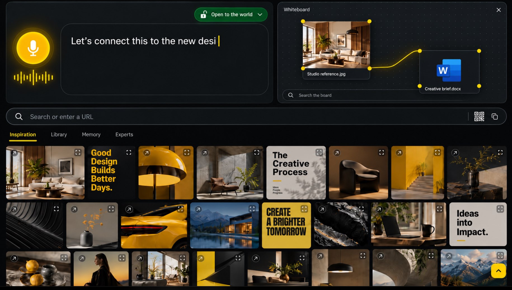
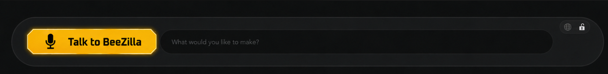
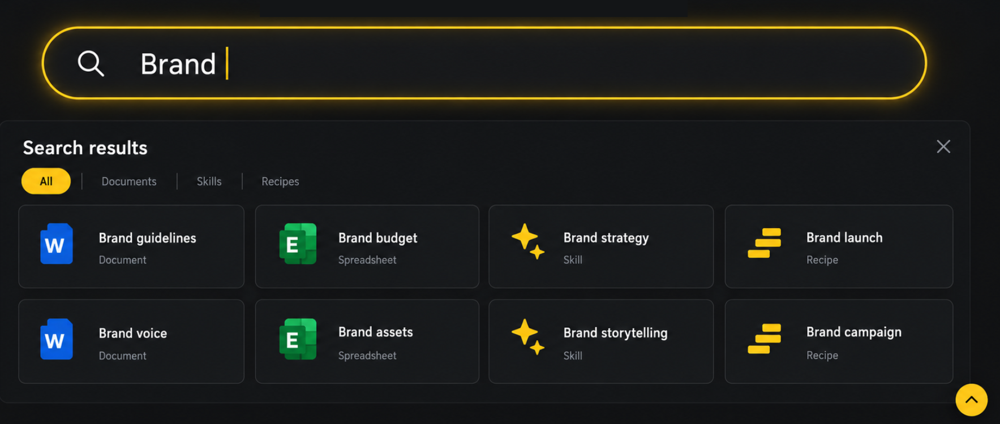
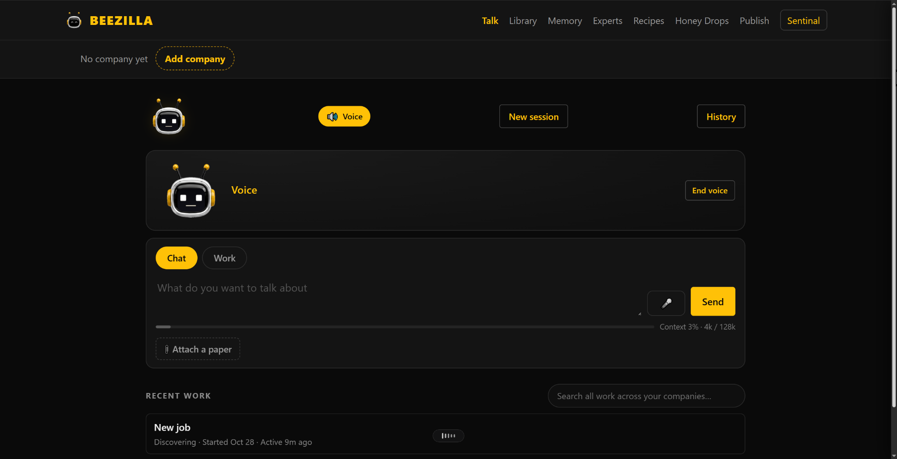

# BeeZilla visual references

The owner supplied these original attachments on 2026-11-13 after direct Imgur retrieval was blocked. All four were visually inspected. Files below preserve the supplied bytes without resizing, recompression or editing; only the attachment filename's `[1]` suffix is removed in repository paths. Source links preserve the original brief mapping but retrieval identity with Imgur could not be independently checked.

Later written owner decisions take precedence: explicit Public versus Selected team sharing, no automatic public opening on share, controllable personal learning, and clear local/cloud privacy boundaries. Mockup labels are not proof of working behavior. These design inputs are not automatically relicensed under MIT.

## zMWSgG0.jpeg

[Original source](https://i.imgur.com/zMWSgG0.jpeg) · 1830 × 1038 · 384611 bytes

Active dark workspace mockup. A glowing yellow microphone and waveform sit left of a large live-text box; a green 'Open to the world' control is above it. On the right, a dotted whiteboard connects a room-photo card ('Studio reference.jpg') to a Word card ('Creative brief.docx') using yellow corner handles and a curved yellow line. Beneath are a search/URL strip with QR and copy icons, Inspiration/Library/Memory/Experts tabs, and a dense image-card wall. This image actually shows the inspiration feed. The tab labels are not identical to the later requested five-item navigation.

SHA-256: `7574180b1c4dc97944b96c0084c449116bc4adc25989a8f1a4fe289acaa70f1a`

Git blob SHA: `4c90973b31d80f44c73754a6026e3a0a90b083a1`

## A6b7ky7.png

[Original source](https://i.imgur.com/A6b7ky7.png) · 1774 × 219 · 318832 bytes

Idle input close-up. A wide rounded dark capsule contains a yellow, clipped-corner 'Talk to BeeZilla' microphone button on the left and a long text input reading 'What would you like to make?'. Globe and unlocked-padlock icons occupy a small top-right control. No plus button is visible. The complete three-mode slider behavior is a written requirement, not demonstrated by this static crop.

SHA-256: `914cb9243f74193ccc466e306add04e3ea54d646b33d45afe9f80355627b7128`

Git blob SHA: `b8c52bee767d788b40f5e1b335149fa400a61b9e`

## qVxl1TJ.png

[Original source](https://i.imgur.com/qVxl1TJ.png) · 1767 × 750 · 966799 bytes

Search-results mockup. A glowing yellow search outline contains 'Brand'. Below, a closeable results panel has All (selected), Documents, Skills and Recipes tabs, with eight cards in two rows: Brand guidelines, Brand budget, Brand strategy, Brand launch, Brand voice, Brand assets, Brand storytelling and Brand campaign. Word/Excel-style icons distinguish documents/spreadsheets; yellow stars and bars distinguish skills/recipes. A yellow up-chevron is at bottom right. No sharing dialog or QR code appears in this image.

SHA-256: `b70e07112f8166897dfba2f639cd2e40387fb694696fbf657ad9256d0cf88065`

Git blob SHA: `54c95db47cf465970c1f61394d4e4f5b1673f503`

## 4v4rpSw.png

[Original source](https://i.imgur.com/4v4rpSw.png) · 2048 × 1050 · 279759 bytes

Existing-interface screenshot, not an inspiration-feed mockup. Dark BeeZilla page with top Talk/Library/Memory/Experts/Recipes/Honey Drops/Publish navigation and a 'Sentinal' account label. Below 'No company yet' and Add company are Voice, New session and History controls, an active Voice panel with End voice, then Chat/Work tabs, a composer with microphone and Send, context meter and Attach a paper. Recent work and a New job card appear below. Use as baseline context, not evidence that the proposed inspiration design is already implemented.

SHA-256: `ba8ea4248c6c712c602c8f2755f4d5d14035947e6a60a455ede7c86c65b71c16`

Git blob SHA: `01afb8874d3c9db1a1b63b16bf966d79542da9d2`

